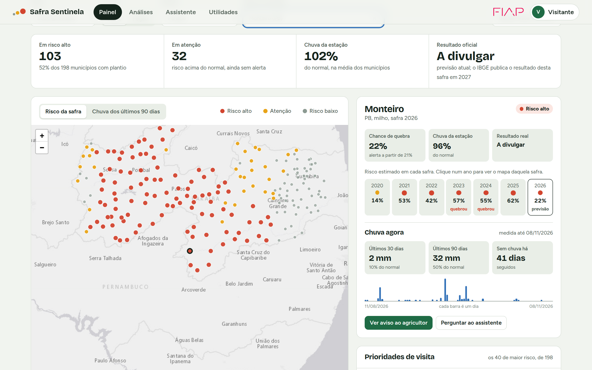

# Safra Sentinela

Alerta de quebra de safra para a agricultura familiar do Semiárido brasileiro.

Projeto do **Grupo RHEAL** (Grupo 42, turma 2TSCOA) para a **Global Solution 2026/2 — CitizenTech**, da FIAP.



## O problema e a ideia

No Semiárido, feijão e milho são plantados quase sempre sem irrigação. Quando a estação chuvosa falha, a família perde a safra, e só fica sabendo quando já plantou tudo. Na seca de 2012, 60% das lavouras municipais de feijão e milho da região tiveram quebra.

O Safra Sentinela cruza o **clima medido por satélite** (NASA) com o **histórico de safras de cada município** (IBGE) e estima, no fim da estação chuvosa, onde a lavoura deve render menos da metade do habitual. O resultado chega de duas formas:

- para o **agricultor**, um aviso curto por WhatsApp, SMS ou áudio, com três ações práticas;
- para **técnicos de extensão e gestores**, um painel com o mapa de risco e a lista de municípios a visitar primeiro.

## Dados atuais

A plataforma trabalha com três camadas de dados, cada uma com sua data:

| Camada | Vai até | De onde vem |
|---|---|---|
| **Chuva recente** (mapa “Chuva dos últimos 90 dias” e bloco “Chuva agora”) | cerca de 3 dias atrás | NASA POWER, dados diários. É o mais próximo de tempo real que a fonte oferece; os dias mais recentes são preliminares e a NASA os revisa depois. |
| **Previsão da safra de 2026** | clima consolidado até setembro de 2026 | Mesmo modelo do notebook, reajustado com todas as safras conhecidas (2003–2025). O IBGE só publica o resultado desta safra em 2027, então a previsão ainda não pode ser conferida. |
| **Safras de 2020 a 2025** | resultado oficial do IBGE | Previsões do teste do notebook, mostradas ao lado do que aconteceu. |

Na última atualização deste repositório (11/11/2026), a chuva ia até **08/11/2026**.

**A chuva se atualiza sozinha.** Ao subir, o servidor verifica a idade dos dados e, se tiverem mais de 12 horas, busca os dias novos na NASA em segundo plano (cerca de um minuto). No painel, o botão **Atualizar chuva** faz o mesmo na hora. Para mudar o intervalo, use `SAFRA_ATUALIZAR_HORAS` (0 desliga a atualização automática).

**A previsão da safra é atualizada por script**, porque depende de retreinar o modelo:

```bash
.venv/bin/pip install -r requirements-analise.txt
.venv/bin/python scripts/atualizar_clima.py        # clima mensal consolidado do ano e chuva diária
.venv/bin/python scripts/prever_safra_atual.py     # confere com o notebook, ajusta o limiar e prevê a safra
.venv/bin/python scripts/preparar_app.py           # leva o resultado para a plataforma
```

Antes de prever, `prever_safra_atual.py` treina o modelo com 2003–2019 e compara as probabilidades de 2020–2025 com as do notebook. Na última execução, a maior diferença foi de 0,00005: o script reproduz o notebook.

## Como rodar a plataforma

Requisito: Python 3.10 ou mais novo.

```bash
./run.sh
```

O script cria o ambiente virtual, instala as duas dependências (FastAPI e Uvicorn) e sobe o servidor. Depois, abra <http://localhost:8000>.

Para usar outra porta: `PORT=8080 ./run.sh`.

No Windows, ou para rodar à mão:

```bash
python -m venv .venv
.venv/bin/pip install -r requirements.txt        # no Windows: .venv\Scripts\pip
.venv/bin/python -m uvicorn app.server:app --port 8000
```

### Como entrar

| Forma | Como |
|---|---|
| Visitante | Botão **Entrar como visitante** na tela de entrada. Abre a plataforma completa, sem senha. É o caminho indicado para quem vai avaliar o projeto. |
| Integrante do grupo | E-mail cadastrado e, como senha, o RM (só os números). |

Para cadastrar outra pessoa:

```bash
.venv/bin/python -m app.auth adicionar pessoa@exemplo.com "Nome Completo" "senha" "Papel"
.venv/bin/python -m app.auth listar
```

As sessões duram 8 horas. Sem a variável `SAFRA_SECRET`, a chave que assina as sessões é sorteada a cada início do servidor, então reiniciar o servidor encerra as sessões abertas.

## O que a plataforma tem

| Página | O que faz |
|---|---|
| **Entrada** | Login com e-mail e senha, ou acesso de visitante. O mapa de pontos ao lado é desenhado com os dados reais da última safra. |
| **Painel** | Mapa por município em dois modos: **risco da safra** e **chuva dos últimos 90 dias**. Filtros de safra, cultura e estado, busca de município, resumo da safra, lista de prioridades de visita e detalhe do município, com o bloco “Chuva agora” (30 e 90 dias, dias seguidos sem chuva e a chuva de cada dia). Clicar num ano do histórico troca a safra do mapa; a legenda liga e desliga cada grupo; a lista pode ser baixada em CSV. |
| **Análises** | Quebras de safra desde 2003, alertas comparados com o resultado real, relação entre chuva e quebra, comparação entre estados (clicar numa barra filtra a página) e um **simulador de limiar**: mova o limite do alerta e veja quantas quebras passam a ser avisadas e quantos alertas falsos isso custa. |
| **Assistente** | Chat que responde sobre o risco de um município, a chuva de agora, os municípios de maior risco de um estado, comparações, histórico, o aviso ao agricultor e o funcionamento do modelo. Lembra do contexto: depois de perguntar por um município, basta dizer “e o feijão?” ou “e em 2023?”. |
| **Utilidades** | Gerador do aviso (WhatsApp e SMS, com botão de copiar), calculadora de perda em sacas e em reais, calendário das chuvas do município, exportação em CSV e glossário. |

No menu do usuário (canto superior direito) ficam o **tema claro ou escuro**, o **tamanho do texto** e o botão de sair. A plataforma funciona em celular e pode ser usada só pelo teclado.

### Sobre o assistente

O assistente **não usa um modelo de linguagem**. Ele interpreta a pergunta (município, estado, cultura, safra e intenção) e calcula a resposta na hora sobre a mesma base do painel. Por isso funciona sem internet e sem chave de API, e toda resposta pode ser conferida no painel. A contrapartida é que ele só entende os assuntos listados acima; perguntas fora disso recebem sugestões do que perguntar.

### Logo da FIAP

O logo oficial está em `web/img/fiap-logo.svg`, baixado do site da FIAP (`https://www.fiap.com.br/svg/courses/fiap.svg`). A marca pertence à FIAP e aparece aqui apenas para identificar o projeto acadêmico. Se o arquivo for removido, a plataforma escreve “FIAP” em texto no lugar.

## O modelo, em resumo

A seção [Detalhamento técnico](#detalhamento-técnico), mais abaixo, traz as fórmulas, os hiperparâmetros e o racional de cada análise.

- **Pergunta respondida:** a lavoura deste município vai render menos de 50% do habitual nesta safra? (O habitual é a média dos cinco anos anteriores; 50% de perda é o mesmo gatilho do programa Garantia-Safra.)
- **Dados:** 1.477 municípios do Semiárido, feijão e milho, safras de 2003 a 2025.
- **Treino e teste:** treino com 2003–2019, teste com 2020–2025, que o modelo nunca viu. A validação cruzada respeita a ordem dos anos.
- **Modelo escolhido:** Gradient Boosting, comparado com Regressão Logística e Random Forest.

| No teste (2020–2025) | Resultado |
|---|---|
| Quebras que receberam alerta | 60% |
| Alertas que se confirmaram | 31% |
| Vantagem sobre a regra simples “choveu pouco” | 1,8 vez (PR-AUC 0,37 contra 0,21) |
| Probabilidade calibrada: erro de calibração | caiu de 0,23 para 0,05 |

A **chance de quebra** mostrada na plataforma é uma probabilidade calibrada. O alerta sai a partir de 25% (20% na safra de 2026): parece pouco, mas a quebra é rara, cerca de 16% das lavouras entre 2020 e 2025.

O desempenho é moderado, e o projeto trata isso às claras: o aviso fala em **risco, não em certeza**. O acerto também é desigual: o modelo avisou 30% das quebras do Ceará contra 77% das da Bahia, e atende pior as lavouras menores e o feijão. O notebook detalha essas limitações.

Os números acima valem para as safras de 2020 a 2025, as únicas em que a previsão pode ser comparada com o resultado. Para a **safra de 2026**, o limiar de alerta foi recalculado com previsões fora da amostra de 2012 a 2025 (0,47), e o acerto variou bastante entre os períodos: de 54% a 87% das quebras avisadas, com 18% a 64% dos alertas confirmados.

## Detalhamento técnico

Esta parte descreve, com as fórmulas e os parâmetros exatos, o que o notebook (`notebook/Safra_Sentinela_ML.ipynb`), os scripts e a plataforma fazem, e por que cada escolha foi feita. Os números vêm da execução registrada no notebook; decimais estão no padrão brasileiro.

Versões usadas: Python 3.14, scikit-learn 1.9.1, pandas 3.1.1, NumPy 2.5.4, FastAPI 0.162, Leaflet 1.9.4 e Chart.js 4.5.1. Semente aleatória: 42 em tudo.

### 1. Formulação do problema

**Unidade de análise.** Uma lavoura municipal: o trio (município *m*, cultura *c*, ano *t*). São 66.236 observações entre 2003 e 2025.

**Variável-alvo.** Seja *r* o rendimento médio em kg/ha registrado pelo IBGE. O rendimento de referência é a média móvel dos cinco anos anteriores, exigindo pelo menos três com dado:

```
r_ref(m, c, t) = média{ r(m, c, t−1), …, r(m, c, t−5) }
quebra(m, c, t) = 1  se  r(m, c, t) < 0,5 × r_ref(m, c, t);  senão 0
```

Lavouras com plantio e colheita zero entram com *r* = 0, portanto como quebra. A taxa de quebra na base é de 19,7% (17,3% no feijão e 22,0% no milho).

**Por que essa definição.**

- **Limite relativo, não absoluto.** O rendimento médio varia cerca de oito vezes entre municípios (do 5º ao 95º percentil). Um corte em kg/ha classificaria como “quebra” permanente os municípios de baixa produtividade. Comparar cada município com o próprio passado mede a perda, que é o que importa para a família.
- **50%.** É o gatilho de perda do programa Garantia-Safra, o que dá ao alvo um significado prático.
- **Só o passado.** `r_ref` usa apenas anos anteriores a *t*. Pode ser calculado antes da safra e não vaza informação do alvo. O custo é perder os três primeiros anos de cada série (2000–2002).
- **Classificação, e não regressão do rendimento.** A decisão que o serviço apoia é binária (avisar ou não). Além disso, numa regressão o erro seria dominado pelo nível de produtividade de cada município, que é estável e pouco informativo sobre a perda do ano.

### 2. Dados e coleta

| Base | Detalhe técnico |
|---|---|
| **IBGE, Produção Agrícola Municipal** | API SIDRA, tabela 5457. Variáveis 8331 (área plantada), 216 (área colhida), 214 (quantidade produzida) e 112 (rendimento médio). Produtos 40112 (feijão em grão) e 40122 (milho em grão), classificação 782. Anos 2000–2025. Requisições por estado e por blocos de nove anos, para ficar abaixo do limite de 100 mil valores por chamada. |
| **NASA POWER, mensal** | Comunidade AG, reanálise MERRA-2, grade de 0,5° de latitude por 0,625° de longitude. Parâmetros: `PRECTOTCORR` (chuva corrigida, mm/dia), `T2M_MAX`, `T2M_MIN`, `RH2M`, `GWETROOT` (umidade do solo na zona das raízes, 0 a 1) e `WS2M`. Anos 1995–2025, e 2026 até setembro. |
| **NASA POWER, diário** | `PRECTOTCORR` dos últimos 120 dias, usado só no acompanhamento da chuva recente. |
| **IBGE, Semiárido** | Lista oficial de 2022, com 1.477 municípios. |

**Tratamento na coleta.**

- No SIDRA, `-` significa zero absoluto e foi convertido em 0; `...` e `X` significam dado indisponível ou sigiloso e viraram ausentes. Ficaram só as linhas com área plantada maior que zero. Não sobrou nenhum valor ausente.
- Cada município foi associado à célula de clima mais próxima da sua sede: `cel_lat = arredonda(lat / 0,5) × 0,5` e `cel_lon = arredonda(lon / 0,625) × 0,625`. Os 1.477 municípios caem em 331 células, então o clima é baixado 331 vezes, e não 1.477.
- A chuva mensal em mm é a média diária multiplicada pelo número de dias do mês.
- Conferência feita com um ponto de teste: no produto mensal da NASA, `T2M_MAX` é a maior máxima diária do mês, `T2M_MIN` é a menor mínima, e as demais variáveis são médias dos dias.

### 3. Construção das variáveis

O modelo usa **58 variáveis**: 56 numéricas e 2 categóricas.

#### 3.1 Estação chuvosa de cada lugar

O Semiárido não tem um calendário único. Para cada célula, a estação chuvosa é a janela de quatro meses seguidos com mais chuva na média histórica:

```
s* = argmax sobre s ∈ {1…12} de  Σ k=0..3  P_normal[(s + k) mod 12]
```

`P_normal` é a chuva média de cada mês calculada **só com os anos até 2019**, que são os de treino. O resultado reproduz os regimes conhecidos: início entre janeiro e março no norte (CE, RN e norte do PI), em novembro ou dezembro no sul (MG, boa parte da BA e sul do PI) e em março ou abril no agreste do leste (AL, SE, leste de PE e da PB).

*Racional:* variáveis alinhadas ao calendário (“chuva de março”) teriam significados diferentes em cada região. Alinhar pela estação local faz “segundo mês de chuva” significar a mesma fase da lavoura em todo o território, e deixa um único modelo servir aos 11 estados.

#### 3.2 Janelas de clima

Para cada célula e ano de colheita são recortados sete meses: os três anteriores ao início das chuvas (`pre3`, `pre2`, `pre1`) e os quatro da estação (`m1` a `m4`). Onde a estação começa entre outubro e dezembro, ela pertence à colheita do ano seguinte.

Em cada um dos sete meses entram seis medidas, somando 42 variáveis:

| Medida | Definição |
|---|---|
| `chuva_mm` | chuva total do mês |
| `chuva_desvio_mm` | chuva do mês menos o normal daquele mês |
| `umidade_solo_raiz` | umidade do solo na zona das raízes |
| `solo_desvio` | umidade do solo menos o normal |
| `temp_max_desvio_c` | temperatura máxima menos o normal |
| `umidade_rel_pct` | umidade relativa do ar |

Há ainda seis agregados: a chuva acumulada antes da estação, nos dois primeiros meses e na estação inteira, cada uma em mm e em percentual do normal.

#### 3.3 O “normal” sem vazamento

O normal de uma variável *x* no ano *t* é a média **apenas dos anos anteriores**, com pelo menos três:

```
normal(t) = média{ x(τ) : τ < t }
desvio(t) = x(t) − normal(t)
percentual(t) = 100 × x(t) / normal(t)
```

*Racional:* se o normal fosse a média de todo o período, cada linha de treino carregaria informação de anos futuros, inclusive dos anos de teste. A média expansiva defasada é exatamente o que estaria disponível em operação. O custo é um normal mais ruidoso nos primeiros anos; por isso o clima começa em 1995, oito anos antes da primeira safra modelada.

#### 3.4 Histórico e contexto

| Variável | Definição | Por que entra |
|---|---|---|
| `rend_ref` | média do rendimento nos 5 anos anteriores | nível de produtividade do município |
| `rend_ano_anterior` | rendimento do ano anterior | persistência de curto prazo |
| `rend_variabilidade` | desvio-padrão dividido pela média dos 5 anos anteriores (coeficiente de variação) | municípios instáveis quebram mais |
| `quebras_5_anos` | número de quebras nos 5 anos anteriores | vulnerabilidade recorrente |
| `log_area_plantada_ant` | log(1 + área plantada no ano anterior) | porte da lavoura; o logaritmo reduz a assimetria |
| `latitude`, `longitude` | sede municipal | gradiente climático que a grade de 50 km não captura |
| `mes_inicio_chuvas` | *s\** da seção 3.1 | regime de chuvas |
| `cultura`, `uf` | categóricas | feijão e milho respondem de modo diferente; efeitos regionais |

Nenhuma variável usa área colhida, produção ou rendimento do próprio ano previsto.

### 4. Desenho de validação

**Divisão cronológica.** Treino com 2003–2019 (48.926 linhas, 21,0% de quebra) e teste com 2020–2025 (17.310 linhas, 15,9% de quebra). O teste foi usado uma única vez, na avaliação final.

*Racional:* a quebra é um fenômeno de anos ruins, e a taxa anual vai de 5% a 60%. Numa divisão aleatória, lavouras vizinhas do mesmo ano cairiam parte no treino e parte no teste, e o modelo aprenderia “2012 foi seco” em vez de aprender a relação entre clima e perda. O resultado pareceria muito melhor do que é.

**Validação cruzada temporal, em blocos de anos.** Cinco dobras em janela expansiva, só dentro do treino:

| Dobra | Treina com | Valida em | Quebra na validação |
|---|---|---|---|
| 1 | 2003–2009 | 2010–2011 | 25% |
| 2 | 2003–2011 | 2012–2013 | 48% |
| 3 | 2003–2013 | 2014–2015 | 25% |
| 4 | 2003–2015 | 2016–2017 | 28% |
| 5 | 2003–2017 | 2018–2019 | 14% |

É a lógica do `TimeSeriesSplit`, mas cortando sempre em fronteiras de ano, para nunca treinar e validar com lavouras da mesma safra.

**Pré-processamento dentro do `Pipeline`.** Em cada dobra, as transformações são ajustadas só com a parte de treino:

- imputação pela mediana (`SimpleImputer`) nas numéricas;
- padronização *z = (x − média) / desvio-padrão* (`StandardScaler`), apenas na Regressão Logística, que é sensível à escala;
- codificação *one-hot* de cultura e estado, ignorando categorias desconhecidas. Depois dela, a matriz tem 69 colunas.

**Desbalanceamento.** Há cerca de uma quebra para quatro safras normais. Os três modelos usam pesos de classe inversamente proporcionais à frequência: *w_k = n / (2 × n_k)*. Preferimos pesos a reamostragem (SMOTE, subamostragem) porque eles não criam lavouras sintéticas nem descartam dados.

**Métrica de seleção: PR-AUC.** É a área sob a curva de precisão e recall, calculada como precisão média: *AP = Σ (R_n − R_{n−1}) × P_n*.

*Racional:* a acurácia é enganosa (prever “nunca quebra” acerta 84% do teste). A ROC-AUC é dominada pela classe majoritária e muda pouco entre modelos. A PR-AUC olha só para a classe de interesse, e seu valor para um modelo sem informação é a própria taxa de quebra (0,16 no teste), o que dá uma régua clara.

**Limiar de decisão.** Para cada modelo, o limiar é o maior valor que ainda avisa 75% das quebras nas previsões fora da amostra da validação cruzada:

```
τ = max{ τ : recall_fora_da_amostra(τ) ≥ 0,75 }
```

*Racional:* não avisar uma quebra custa a safra de uma família; um alerta falso custa cautela e a visita de um técnico. Como os custos são assimétricos, fixamos o recall e aceitamos a precisão que vier. O limiar é escolhido sem tocar no teste.

### 5. Modelos e hiperparâmetros

Os hiperparâmetros foram escolhidos por busca em grade (`GridSearchCV`) com as cinco dobras temporais, maximizando a PR-AUC média.

| | Regressão Logística | Random Forest | Gradient Boosting (escolhido) |
|---|---|---|---|
| Classe do scikit-learn | `LogisticRegression` | `RandomForestClassifier` | `HistGradientBoostingClassifier` |
| Papel | linha de base linear e interpretável | conjunto de árvores independentes | árvores em sequência, cada uma corrigindo a anterior |
| Parâmetros fixos | penalidade L2, otimizador L-BFGS, `max_iter=2000`, `class_weight="balanced"` | 300 árvores, critério de Gini, amostragem *bootstrap*, sem limite de profundidade, `class_weight="balanced_subsample"` | perda logarítmica, até 300 árvores, `min_samples_leaf=20`, 255 faixas por variável, sem penalidade L2, `class_weight="balanced"` |
| Grade testada | `C` ∈ {0,01; 0,1; 1} | `min_samples_leaf` ∈ {5; 20} e `max_features` ∈ {raiz quadrada; 0,3} | `learning_rate` ∈ {0,03; 0,1} e `max_leaf_nodes` ∈ {8; 31} |
| Escolhido | `C` = 0,01 | `min_samples_leaf` = 5, `max_features` = raiz quadrada (8 das 69 colunas por divisão) | `learning_rate` = 0,03, `max_leaf_nodes` = 8 |
| PR-AUC média na validação | 0,489 | 0,471 | **0,497** |
| Limiar (recall de 75%) | 0,571 | 0,296 | 0,509 |

**Regressão Logística.** Modela *p = 1 / (1 + e^−(w·x + b))* e minimiza a perda logarítmica ponderada mais a penalidade *‖w‖² / (2C)*. O melhor `C` foi o menor da grade, isto é, a regularização mais forte: sinal de que muitas das 58 variáveis são redundantes entre si (por exemplo, a chuva de um mês e seu desvio).

**Random Forest.** Média das probabilidades de 300 árvores, cada uma treinada numa reamostragem com reposição e sorteando 8 colunas candidatas por divisão. Com `balanced_subsample`, os pesos de classe são recalculados em cada reamostragem.

**Gradient Boosting por histogramas.** O modelo soma árvores pequenas em sequência:

```
F_0 = log-chance inicial
F_k(x) = F_{k−1}(x) + ν × h_k(x)        ν = 0,03 (taxa de aprendizado)
p(x) = 1 / (1 + e^−F_K(x))
```

Cada árvore *h_k* é ajustada ao gradiente da perda logarítmica, com no máximo 8 folhas. As variáveis numéricas são discretizadas em até 255 faixas, o que torna o treino rápido e trata valores ausentes de forma nativa.

- A combinação escolhida (taxa baixa, árvores pequenas) é a mais conservadora da grade. É coerente com um problema ruidoso, em que árvores grandes decoram os anos de treino.
- A parada antecipada do scikit-learn fica ativa por padrão acima de 10 mil linhas: 10% do treino é separado e o treino para depois de 10 iterações sem melhora. Aqui o modelo usou as 300 árvores. Essa separação interna é aleatória dentro do treino e não toca o teste.

**Regra da chuva (referência sem aprendizado).** Alerta quando a chuva da estação fica abaixo de um percentual do normal. Com a mesma regra de recall, o corte ficou em 87%. Serve para responder a uma pergunta honesta: o aprendizado de máquina acrescenta algo a “choveu pouco”?

*Racional da escolha dos três modelos:* eles formam uma escada de flexibilidade. Se o modelo linear empatasse com os de árvores, o limite estaria nos dados; se as árvores ganhassem com folga, haveria interações importantes. O que se viu foi quase um empate (seção 6).

### 6. Resultados

**Validação cruzada (previsões fora da amostra, 2010–2019), no limiar escolhido:**

| Modelo | Recall | Precisão | F1 | Acurácia | PR-AUC | ROC-AUC |
|---|---|---|---|---|---|---|
| Regressão Logística | 0,75 | 0,44 | 0,56 | 0,67 | 0,56 | 0,76 |
| Random Forest | 0,75 | 0,41 | 0,53 | 0,64 | 0,46 | 0,73 |
| Gradient Boosting | 0,75 | 0,44 | 0,56 | 0,67 | 0,53 | 0,76 |
| Regra da chuva | 0,75 | 0,37 | 0,50 | 0,58 | 0,46 | 0,70 |

Nesta tabela a PR-AUC junta os cinco blocos numa conta só, e por isso difere da média das dobras usada na seleção (0,489, 0,471 e 0,497).

**Teste (2020–2025), com o limiar fixado na validação:**

| Modelo | Recall | Precisão | F1 | Acurácia | PR-AUC | ROC-AUC | Lavouras alertadas |
|---|---|---|---|---|---|---|---|
| Regressão Logística | 0,55 | 0,32 | 0,41 | 0,74 | 0,34 | 0,74 | 27% |
| Random Forest | 0,65 | 0,27 | 0,38 | 0,66 | 0,33 | 0,71 | 39% |
| **Gradient Boosting** | **0,60** | **0,31** | **0,41** | **0,72** | **0,37** | **0,74** | **31%** |
| Regra da chuva | 0,58 | 0,20 | 0,30 | 0,56 | 0,21 | 0,60 | 46% |

**Matriz de confusão do Gradient Boosting no teste:**

| | Previsto: normal | Previsto: quebra |
|---|---|---|
| **Real: normal** | 10.807 | 3.751 (alertas falsos) |
| **Real: quebra** | 1.101 (quebras sem aviso) | 1.651 (quebras avisadas) |

**Leitura.**

- **O modelo escolhido foi definido antes do teste**, pela PR-AUC média das dobras. A vantagem sobre a Regressão Logística é pequena (0,497 contra 0,489).
- **O aprendizado de máquina acrescenta informação.** A PR-AUC do Gradient Boosting é 0,37, contra 0,21 da regra da chuva e 0,16 de um modelo sem informação. Alertando 31% das lavouras, ele alcança 60% das quebras; a regra precisa alertar 46% para alcançar 58%.
- **Os três modelos quase empatam.** Isso indica que o limite está nos dados (clima mensal em grade de 50 km, produção em média municipal), e não no algoritmo.
- **O recall caiu de 75% para 60% entre validação e teste.** O limiar foi calibrado em 2010–2019, período com 28% de quebras, e aplicado a 2020–2025, com 16%. A relação entre a pontuação do modelo e a frequência real de quebra mudou entre os períodos. Em operação, o limiar precisa ser recalibrado a cada safra.

### 6.1 Calibração: da pontuação à probabilidade

**O problema.** Os pesos de classe fazem o modelo tratar quebras e safras normais como igualmente frequentes. Isso melhora a ordenação, mas infla a saída: no teste, a pontuação média era 0,39, contra 16% de quebras reais. A pontuação serve para ordenar, não para dizer “a chance é de 40%”.

**A solução: calibração de Platt.** Uma regressão logística de uma variável sobre o logit da pontuação *s*:

```
p = σ( a × logit(s) + b )        logit(s) = ln( s / (1 − s) )        σ(z) = 1 / (1 + e^−z)
ajuste do notebook:  a = 0,871   b = −1,118
```

Os dois parâmetros são ajustados **só com as previsões fora da amostra do treino** (cada ano de 2010 a 2019 previsto por um modelo que não o viu). Ajustar a calibração nas previsões dentro da amostra seria aprender a corrigir um modelo otimista demais.

**Por que Platt, e não regressão isotônica.** As duas foram comparadas ainda dentro do treino, em validação para a frente: calibra-se nos blocos anteriores e mede-se o escore de Brier no bloco seguinte.

| Método | Brier em 2014–15 | Brier em 2016–17 | Brier em 2018–19 | Média |
|---|---|---|---|---|
| **Platt** | 0,219 | 0,179 | 0,114 | **0,171** |
| Isotônica | 0,226 | 0,180 | 0,114 | 0,173 |

Além de ter o menor Brier, a curva de Platt é estritamente crescente: **não muda a ordem das lavouras**, então recall, precisão, PR-AUC e o conjunto de alertas ficam exatamente como antes. A isotônica é uma função em degraus e reduziria as 17 mil previsões a 74 valores distintos, criando empates no ranking. Com poucos anos independentes, um método de dois parâmetros também é menos sujeito a decorar o período de ajuste.

**Como se mede a calibração.**

```
Brier = (1/n) Σ (p_i − y_i)²                       erro quadrático da probabilidade
ECE   = Σ_g (n_g / n) × | freq. real_g − prob. média_g |     g: dez grupos de mesmo tamanho
Habilidade de Brier = 1 − Brier / Brier_ref        ref.: prever sempre a taxa de quebra do treino (21%)
```

**Resultado no teste (2020–2025).**

| | Probabilidade média prevista | Frequência real | Brier | ECE | Habilidade de Brier | PR-AUC |
|---|---|---|---|---|---|---|
| Pontuação bruta | 39% | 16% | 0,183 | 0,227 | −0,35 | 0,371 |
| **Calibrada (Platt)** | **20%** | 16% | **0,122** | **0,046** | **0,11** | 0,371 |
| Isotônica (alternativa) | 20% | 16% | 0,122 | 0,047 | 0,10 | 0,359 |

A pontuação bruta era pior, como probabilidade, do que prever a média histórica para todas as lavouras (habilidade negativa). A calibrada é melhor que a média, com ganho modesto.

**Confiabilidade por décimo das lavouras (teste).**

| Décimo | 1 | 2 | 3 | 4 | 5 | 6 | 7 | 8 | 9 | 10 |
|---|---|---|---|---|---|---|---|---|---|---|
| Probabilidade prevista | 4% | 6% | 9% | 11% | 14% | 18% | 23% | 29% | 38% | 53% |
| Frequência real | 2% | 4% | 7% | 9% | 12% | 14% | 19% | 23% | 27% | 43% |

**O que ainda sobra.** A probabilidade calibrada continua um pouco alta: em média, cinco pontos percentuais acima da frequência real, e dez pontos no décimo de maior risco. A calibração foi aprendida em 2010–2019, período com mais quebras do que 2020–2025. Ano a ano, a diferença entre a média prevista e a real foi de −3 a +13 pontos. É uma probabilidade utilizável, não exata: de cada dez lavouras com “40% de chance”, cerca de três quebraram.

**Limiar em probabilidade.** O alerta continua sendo decidido na pontuação (0,509), o que equivale a 25,2% de probabilidade calibrada. O nível “atenção” começa em 13,5%. Os valores parecem baixos porque o evento é raro: um município com 25% de chance tem cerca de uma vez e meia o risco médio.

**O que a plataforma guarda.** Cada linha tem a `pontuacao` (saída bruta, que define o alerta e o nível) e a `prob_quebra` (calibrada, que é o número mostrado).

### 7. As análises e o racional de cada uma

| Análise | O que foi feito | Por que foi feita | O que mostrou |
|---|---|---|---|
| **Quebras por ano** (exploratória) | Taxa de quebra por ano, 2003–2025 | Saber se a quebra é um risco constante ou concentrado em anos | Vai de 5% (2020) a 60% (2012). Justifica a divisão temporal e os blocos de anos |
| **Quebra por faixa de chuva** (só treino) | Taxa de quebra em sete faixas de chuva da estação, em % do normal | Verificar se a principal hipótese do projeto aparece nos dados | Relação clara e monotônica, mas não determinística: mesmo com chuva normal parte das lavouras quebra. Justifica ir além de uma regra de chuva |
| **Mapa da frequência de quebra** (só treino) | Taxa de quebra de cada município entre 2003 e 2019 | Ver se o risco é homogêneo no território | Concentra-se no núcleo do sertão e é rara em MG, ES e MA. Justifica latitude, longitude e estado como variáveis, e antecipa o risco de viés regional |
| **Comparação de modelos e curvas de precisão e recall** | Métricas e curvas dos três modelos e da regra, no teste | Mostrar o desempenho em todos os limiares, e não só no escolhido | O Gradient Boosting domina a regra em toda a curva; os três modelos se confundem acima de 50% de recall |
| **Matrizes de confusão** | Contagem dos quatro desfechos | Traduzir as métricas em número de lavouras, que é como o gestor pensa | 1.101 quebras sem aviso e 3.751 alertas falsos em seis anos |
| **Calibração** (seção 6.1) | Platt e isotônica comparadas em validação para a frente; diagrama de confiabilidade, Brier e ECE no teste | Para que a “chance de quebra” informada possa ser lida como probabilidade | ECE de 0,23 para 0,05, sem mudar a ordem das lavouras |
| **Importância por permutação** | Queda na PR-AUC do teste ao embaralhar cada variável, 5 repetições | Entender em que o modelo se apoia. A permutação mede o efeito em dados novos e não favorece variáveis com muitos valores distintos, como faz a importância interna das árvores | Ver abaixo |
| **Antecedência** | O mesmo modelo, reajustado com a informação disponível em três momentos | Saber quando o aviso passa a ser útil | Ver abaixo |
| **Alertas e quebras por ano** | Percentual de lavouras alertadas e de quebras reais, ano a ano | Ver se o modelo acompanha os anos ruins | Acompanha a direção (mais alertas em 2021, 2023 e 2025), mas alerta bem mais do que quebra |
| **Equidade entre grupos** | Recall e precisão por estado, por quartil de área plantada e por cultura | O enunciado pede atenção a vieses; um limiar único pode atender mal alguns grupos | Ver abaixo |

**Importância das variáveis (Gradient Boosting, teste).** As dez maiores quedas de PR-AUC:

| Variável | Queda |
|---|---|
| `latitude` | 0,055 |
| `uf` | 0,029 |
| `rend_variabilidade` | 0,028 |
| `rend_ano_anterior` | 0,027 |
| `rend_ref` | 0,016 |
| `temp_max_desvio_c_m3` | 0,016 |
| `chuva_m1m2_mm` | 0,014 |
| `chuva_mm_m4` | 0,012 |
| `umidade_rel_pct_m3` | 0,007 |
| `longitude` | 0,006 |

Somando por grupo: localização e calendário 0,091; histórico do município 0,071; clima da estação chuvosa 0,055; clima antes das chuvas −0,006 (ruído em torno de zero).

O modelo responde a duas perguntas. *Quem* é vulnerável, pela localização e pelo histórico; e *quando*, pelo clima da estação. O peso alto da localização é um ponto de atenção: parte do que foi aprendido é “nesta região costuma quebrar”, o que funciona enquanto o padrão regional se mantém e ajuda a explicar o desempenho desigual entre estados. Como as variáveis de clima são correlacionadas entre si, a permutação tende a subestimar a importância de cada uma isoladamente.

**Antecedência do aviso (teste).**

| Cenário | Informação usada | Recall | Precisão | PR-AUC |
|---|---|---|---|---|
| A, antes do plantio | histórico e 3 meses antes das chuvas | 0,74 | 0,20 | 0,25 |
| B, meio da estação | A e os 2 primeiros meses de chuva | 0,74 | 0,24 | 0,29 |
| C, fim da estação | B e os 2 últimos meses de chuva | 0,60 | 0,31 | 0,37 |

Antes do plantio, o modelo reflete quase só a vulnerabilidade histórica e geográfica. Dois terços do ganho vêm dos dois últimos meses de chuva. O aviso confiável sai no fim da estação: é útil para antecipar seguro e assistência, mas tarde para decidir o plantio. Para dar antecedência real, seria preciso usar previsão climática sazonal.

**Equidade (teste, Gradient Boosting).**

| Grupo | Lavouras | Taxa de quebra | Recall | Precisão |
|---|---|---|---|---|
| Bahia | 3.376 | 15% | 0,77 | 0,22 |
| Paraíba | 2.376 | 28% | 0,75 | 0,44 |
| Piauí | 2.592 | 19% | 0,65 | 0,32 |
| Pernambuco | 1.490 | 17% | 0,57 | 0,29 |
| Rio Grande do Norte | 1.743 | 21% | 0,46 | 0,41 |
| Ceará | 2.100 | 16% | 0,30 | 0,27 |
| Minas Gerais | 2.538 | 2% | 0,08 | 0,04 |
| Menores áreas plantadas (1º quartil) | 4.328 | 11% | 0,49 | 0,29 |
| Maiores áreas plantadas (4º quartil) | 4.325 | 18% | 0,58 | 0,30 |
| Feijão | 8.684 | 15% | 0,51 | 0,30 |
| Milho | 8.626 | 16% | 0,68 | 0,31 |

Parte da diferença entre estados vem de onde a quebra é rara (Minas Gerais). Mas Ceará e Bahia tiveram taxas de quebra parecidas e recalls de 30% e 77%: com um limiar único, o agricultor cearense recebe muito menos avisos para um risco semelhante. Antes de operar, o limiar deve ser calibrado por região e o recall acompanhado por grupo.

### 8. Previsão da safra de 2026

Implementada em `scripts/modelo.py` e `scripts/prever_safra_atual.py`.

1. **Conferência com o notebook.** O script reconstrói as variáveis fora do notebook, treina com 2003–2019 e compara as 17.310 probabilidades de teste com as do notebook. A maior diferença foi 0,00005. Sem essa conferência, não haveria garantia de que a plataforma usa o mesmo modelo que foi avaliado.
2. **Limiar com dados mais recentes.** Sete blocos em janela expansiva, de 2012–2013 a 2024–2025, com a mesma regra de 75% de recall. Resultado: τ = 0,472.
3. **Calibração.** Curva de Platt ajustada nas mesmas previsões fora da amostra (2012–2025): *a* = 0,885 e *b* = −1,254. Em probabilidade, o alerta sai a partir de 20,5%.
4. **Reajuste final.** Mesmos hiperparâmetros, treino com todas as safras conhecidas (2003–2025, 66.236 linhas).
5. **Lavouras previstas.** As que tiveram plantio em 2025 e têm pelo menos três anos de histórico: 2.869. Resultado: 31% em risco alto (38% no milho, 24% no feijão), probabilidade média de quebra de 17% e chuva média da estação em 88% do normal.

*Racional do reajuste:* o desenho de 2003–2019 contra 2020–2025 serve para medir o modelo. Para prever, descartar os seis anos mais recentes seria jogar fora a informação mais relevante.

*Racional do novo limiar:* um modelo reajustado tem outra escala de pontuação, então o limiar antigo (0,509) não se transfere.

**Instabilidade entre períodos.** O desempenho fora da amostra, bloco a bloco, com o limiar de 0,472:

| Bloco | Quebras avisadas | Alertas confirmados | Lavouras alertadas |
|---|---|---|---|
| 2012–2013 | 87% | 64% | 65% |
| 2014–2015 | 87% | 31% | 69% |
| 2016–2017 | 76% | 40% | 52% |
| 2018–2019 | 55% | 28% | 28% |
| 2020–2021 | 70% | 18% | 35% |
| 2022–2023 | 54% | 27% | 32% |
| 2024–2025 | 65% | 44% | 34% |

**Calibração validada para a frente** (calibra nos blocos anteriores, avalia no bloco):

| Bloco | Probabilidade média prevista | Frequência real | Brier (bruta → calibrada) | ECE (bruta → calibrada) |
|---|---|---|---|---|
| 2016–2017 | 28% | 28% | 0,227 → 0,179 | 0,196 → 0,023 |
| 2018–2019 | 20% | 14% | 0,168 → 0,114 | 0,221 → 0,058 |
| 2020–2021 | 19% | 9% | 0,184 → 0,095 | 0,281 → 0,105 |
| 2022–2023 | 17% | 16% | 0,186 → 0,127 | 0,222 → 0,029 |
| 2024–2025 | 19% | 23% | 0,175 → 0,146 | 0,168 → 0,043 |

A calibração melhora todos os blocos, mas erra a média em anos atípicos: superestimou em 2020–2021, de poucas quebras, e subestimou em 2024–2025.

A previsão de 2026 não pode ser conferida até o IBGE publicar o resultado, em 2027. As tabelas acima são a melhor indicação do que esperar.

### 9. Chuva recente

Implementada em `app/clima.py`.

- **Janelas.** Chuva acumulada nos últimos 30 e 90 dias, até o último dia publicado pela NASA.
- **Normal do período.** O normal mensal de cada município (média até 2019) é rateado pelos dias da janela: *normal = Σ sobre os dias de P_normal[mês do dia] / dias do mês*.
- **Classes do mapa.** Percentual do normal em 90 dias: menos de 50% (muito abaixo), 50 a 80% (abaixo), 80 a 120% (dentro do normal), mais de 120% (acima).
- **Época seca.** Onde o normal é menor que 0,55 mm por dia (cerca de 50 mm em 90 dias), não há comparação: dividir uma chuva pequena por um normal quase nulo produz percentuais sem sentido.
- **Dias sem chuva.** Dias seguidos, até o último dia medido, com menos de 1 mm.

**Por que a chuva recente não entra no modelo.** Os dias recentes vêm de um produto preliminar da NASA, diferente do consolidado usado no treino. No ponto de teste, a umidade do solo passou de cerca de 0,57 para 0,35 exatamente na troca de produto, uma descontinuidade que não é física. Alimentar o modelo com esses dados introduziria um viés. A chuva recente serve para acompanhamento; o risco da safra usa só o produto consolidado.

### 10. Assistente

Implementado em `app/chat.py`, sem modelo de linguagem.

1. **Normalização.** Minúsculas e remoção de acentos.
2. **Entidades.**
   - Safra: expressão regular para o ano.
   - Cultura: os termos “milho” e “feij”.
   - Estado: pelo nome; pela sigla só em maiúsculas, para não confundir “PE” com “pé” ou “SE” com “se”.
   - Município: o nome mais longo encontrado com fronteira de palavra entre os 1.477. Nomes de uma palavra só (“Saúde”, “Central”) exigem preposição de lugar antes ou inicial maiúscula. Homônimos são resolvidos pelo estado citado, ou o assistente pergunta qual.
3. **Intenção.** Onze intenções por palavras-chave, em ordem de prioridade: chuva de agora, comparação, aviso, modelo, orientação, histórico, chuva da estação, ranking, resumo, ajuda e risco do município.
4. **Contexto.** O navegador devolve o último município, estado, safra e cultura. Uma pergunta só com uma entidade (“e o feijão?”) reaproveita a intenção anterior.
5. **Resposta.** Texto mais blocos estruturados (indicadores, tabela, cartão de município, série, aviso), todos calculados na hora sobre a mesma base do painel.

*Racional:* num projeto sobre confiança em dados, um assistente que não pode inventar números vale mais que um que conversa sobre qualquer coisa. A contrapartida é o escopo fechado.

### 11. Arquitetura da plataforma

```
 Fontes públicas                Processamento (scripts/)                 Plataforma
┌────────────────┐   ┌──────────────────────────────────────┐   ┌──────────────────────────┐
│ IBGE SIDRA     │──▶│ coletar_dados.py   → data/*.csv      │   │ app/ (FastAPI)           │
│ NASA POWER     │──▶│ notebook (ML)      → previsões teste │──▶│  dados.py   CSV em memória│
│  mensal        │──▶│ atualizar_clima.py → clima de 2026   │   │  chat.py    assistente    │
│ IBGE Semiárido │   │ prever_safra_atual → previsão 2026   │   │  auth.py    sessão        │
└────────────────┘   │ preparar_app.py    → app/data/*.csv  │   │  clima.py ◀── NASA diário │
                     └──────────────────────────────────────┘   │        (atualiza sozinho) │
                                                                 └────────────┬─────────────┘
                                                                              │ JSON
                                                                 ┌────────────▼─────────────┐
                                                                 │ web/ (HTML, CSS, JS)      │
                                                                 │ Painel · Análises ·       │
                                                                 │ Assistente · Utilidades   │
                                                                 └──────────────────────────┘
```

- **Servidor.** FastAPI com Uvicorn. Os CSVs (cerca de 3 MB) são lidos uma vez e ficam em memória; as consultas são filtros sobre listas. Não há banco de dados nem scikit-learn no servidor: as previsões chegam prontas dos scripts.
- **Chuva recente.** Download com a biblioteca padrão (`urllib`), seis conexões em paralelo, gravação atômica (arquivo temporário e troca) e uma trava para evitar duas atualizações simultâneas. Se a NASA estiver fora do ar, os dados anteriores são mantidos.
- **Login.** Senhas com PBKDF2-HMAC-SHA256, 200 mil iterações e sal de 16 bytes por usuário. A sessão é um cookie `HttpOnly` e `SameSite=Lax`, com conteúdo assinado por HMAC-SHA256 e validade de 8 horas. As comparações usam tempo constante.
- **Interface.** JavaScript em módulos nativos, sem etapa de build. Navegação por *hash*; cada página é carregada sob demanda. O mapa usa o renderizador *canvas* do Leaflet para desenhar 1.400 pontos com fluidez. Os filtros são compartilhados entre as páginas e guardados no navegador.
- **Simulador de limiar.** O servidor envia a distribuição das probabilidades em 100 faixas de 0,01, separada por desfecho. O navegador recalcula recall, precisão e os quatro desfechos por soma acumulada, sem nova chamada. Por causa das faixas, os números podem diferir em uma ou duas lavouras do cálculo exato.

### 12. Limites estatísticos

- **A probabilidade calibrada ainda é um pouco alta.** No teste, fica em média cinco pontos percentuais acima da frequência real, e erra mais em anos atípicos (seção 6.1). A calibração depende do período em que foi aprendida e precisa ser refeita a cada safra.
- **Sem intervalos de confiança.** Lavouras do mesmo ano e de municípios vizinhos são correlacionadas, então o tamanho efetivo da amostra é muito menor que 17 mil. As diferenças pequenas entre modelos não devem ser lidas como significativas. Uma estimativa honesta de incerteza exigiria reamostragem por blocos de anos.
- **Poucos anos independentes.** O teste tem seis safras e a validação, dez. Um único ano atípico muda as métricas, como mostra a tabela da seção 8.
- **Grade de hiperparâmetros pequena.** Foram testadas de três a quatro combinações por modelo. O empate entre os modelos sugere que uma busca maior renderia pouco.
- **Alvo com ruído.** O rendimento municipal é estimado por agentes locais do IBGE e mistura sequeiro com irrigação. Parte do erro do modelo é erro do alvo.
- **Resolução.** Municípios vizinhos compartilham a mesma célula de clima, e dados mensais não mostram veranicos (dias secos dentro de um mês de total normal).
- **Calendário fixo de chuvas.** A estação chuvosa foi definida com a média até 2019 e não se adapta a anos em que a chuva atrasa.

**Próximos passos técnicos:** chuva diária em alta resolução (CHIRPS) para medir veranicos; previsão climática sazonal para dar antecedência antes do plantio; calibração por região; limiares por região; e dados de perda por agricultor, como os registros do Garantia-Safra, para sair da média municipal.

## Estrutura do projeto

```
safra-sentinela/
├── run.sh                      sobe a plataforma
├── requirements.txt            dependências da plataforma
├── requirements-analise.txt    dependências da coleta, do notebook e dos slides
├── app/                        servidor (FastAPI)
│   ├── server.py               rotas da API e arquivos estáticos
│   ├── auth.py                 login, senhas (PBKDF2) e sessão em cookie assinado
│   ├── dados.py                leitura dos CSVs e consultas
│   ├── clima.py                chuva recente: download da NASA, resumo por município e atualização automática
│   ├── chat.py                 assistente
│   ├── mensagens.py            texto do aviso ao agricultor
│   ├── usuarios.json           usuários cadastrados (senhas em hash)
│   └── data/                   dados que a plataforma consome
├── web/                        interface (HTML, CSS e JavaScript puros, sem etapa de build)
│   ├── index.html
│   ├── css/app.css
│   ├── js/                     main, nucleo, painel, analises, chat, utilidades
│   ├── img/                    marca do projeto e logo da FIAP
│   └── vendor/                 Leaflet 1.9.4 e Chart.js 4.5.1
├── scripts/
│   ├── coletar_dados.py        baixa IBGE (PAM e lista do Semiárido) e NASA POWER
│   ├── atualizar_clima.py      clima consolidado do ano corrente e chuva diária recente
│   ├── modelo.py               variáveis e modelo, iguais aos do notebook
│   ├── prever_safra_atual.py   previsão da safra que ainda não tem resultado oficial
│   ├── preparar_app.py         gera app/data a partir da coleta e do notebook
│   └── montar_slides.py        gera o pitch em PPTX
├── data/                       CSVs da coleta
├── notebook/                   notebook de Machine Learning, figuras e previsões
├── pitch/                      proposta executiva (PPTX e PDF)
└── prototipo/                  capturas de tela
```

## Refazer tudo do zero

```bash
.venv/bin/pip install -r requirements-analise.txt

.venv/bin/python scripts/coletar_dados.py        # baixa os dados públicos (alguns minutos)

cd notebook                                       # treina os modelos (cerca de 5 minutos)
../.venv/bin/jupytext --to ipynb Safra_Sentinela_ML.py -o Safra_Sentinela_ML.ipynb
../.venv/bin/jupyter nbconvert --to notebook --execute --inplace Safra_Sentinela_ML.ipynb
cd ..

.venv/bin/python scripts/atualizar_clima.py      # clima de 2026 e chuva recente
.venv/bin/python scripts/prever_safra_atual.py   # previsão da safra de 2026
.venv/bin/python scripts/preparar_app.py         # atualiza os dados da plataforma
.venv/bin/python scripts/montar_slides.py        # regera os slides
```

## API

Todas as rotas de dados exigem sessão. A documentação interativa fica em `/api/docs`.

| Rota | Descrição |
|---|---|
| `POST /api/login`, `POST /api/login/visitante`, `POST /api/logout`, `GET /api/eu` | Sessão |
| `GET /api/publico/pontos` | Pontos do mapa da tela de entrada (única rota sem login) |
| `GET /api/opcoes` | Safras, culturas e estados disponíveis |
| `GET /api/risco?ano=&cultura=&uf=` | Resumo e lista de municípios de uma safra |
| `GET /api/municipio/{cod_ibge}?ano=&cultura=` | Detalhe, histórico, calendário de chuvas e aviso |
| `GET /api/municipios?q=` | Busca de município por nome |
| `GET /api/analises?cultura=&uf=` | Séries e agregados da página de análises |
| `GET /api/clima/mapa`, `GET /api/clima/status`, `POST /api/clima/atualizar` | Chuva recente por município, situação da atualização e pedido de atualização |
| `POST /api/chat` | Pergunta ao assistente (`mensagem` e `contexto`) |
| `GET /api/exportar.csv?ano=&cultura=&uf=` | Lista de municípios em CSV |

## Fontes de dados

| Fonte | Uso |
|---|---|
| [IBGE, Produção Agrícola Municipal (tabela SIDRA 5457)](https://sidra.ibge.gov.br/tabela/5457) | Área, produção e rendimento de feijão e milho por município |
| [NASA POWER](https://power.larc.nasa.gov) | Chuva, temperatura e umidade do solo, mês a mês |
| [IBGE, delimitação do Semiárido (2022)](https://geoftp.ibge.gov.br/organizacao_do_territorio/estrutura_territorial/semiarido_brasileiro/) | Lista oficial dos municípios |
| Esri, HERE, Garmin e OpenStreetMap | Mapa de fundo do painel |

## Limites desta versão

- É um protótipo acadêmico. O envio real de WhatsApp e SMS não está implementado: a plataforma gera o texto do aviso, e o áudio é ilustrativo.
- O login protege a demonstração, mas não é um sistema de identidade: a senha dos integrantes é o RM, que é curto e fácil de adivinhar. Não publique a plataforma na internet com esses usuários.
- “Tempo real” aqui significa o que a NASA já publicou: cerca de três dias de atraso. Os dias recentes vêm de um produto preliminar, diferente do consolidado usado no treino, e podem ser revisados; por isso a chuva recente serve para acompanhar, e não entra no cálculo do risco da safra.
- Em 2026, só entram as lavouras de municípios que tiveram plantio em 2025, porque a área plantada de 2026 ainda não foi divulgada.
- A comparação com o normal não é feita onde o período é normalmente seco (menos de cerca de 50 mm esperados em 90 dias).
- O dado de produção é a média do município, não a situação de cada família, e o clima vem de uma grade de cerca de 50 km.
- O mapa de fundo e as fontes tipográficas são carregados da internet; sem conexão, o painel funciona, mas o mapa fica sem fundo.

## Equipe

Arthur Evangelista Thomazini · Elom Eduardo Maio Nascimento · Henrique Soares Meira · Luiz Phelipe Silva Menezes Araujo · Raphael Martins Teixeira Amaral
